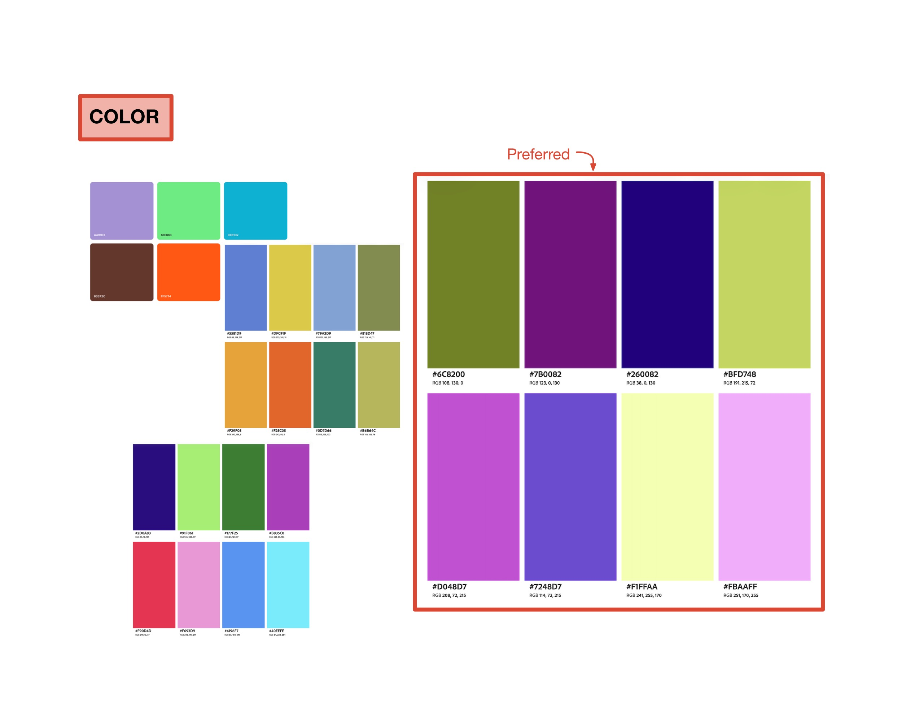
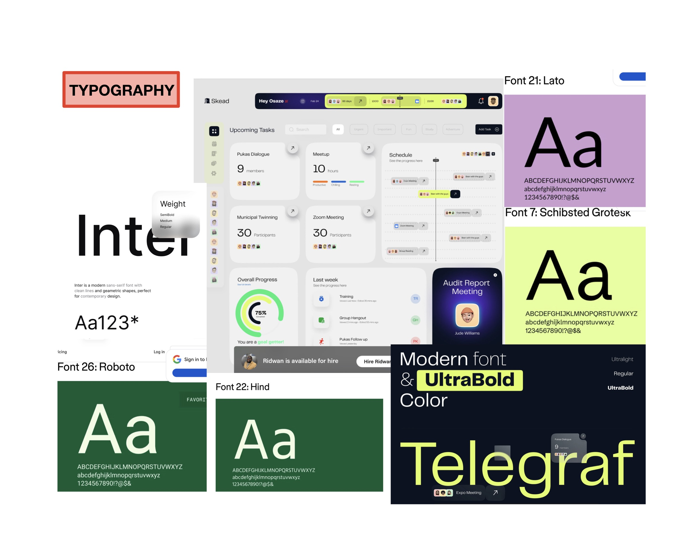

# **BFS-this-MESS**

## USER JOURNEY
Omar is a junior in 6-3 and it is the week before registration. Instead of editing the same road in CourseRoad again, he registers for BFS-this-MESS and sets his initial state: the subjects he has already completed are pinned to the semesters he took them in, and those semesters are locked.

He creates a road and sets his constraints: the 6-3 requirements, at most 4 subjects per semester (3 of them technical), and 6.1220 pinned to the semester he wants it in. He then requests possible paths, and the application computes and displays the shortest valid plans for his road, with his locked semesters first and his pins marked.

Omar compares the paths semester by semester, using class ratings and unit count.

## VISUAL DESIGN STUDY
* Use rounded edges to inspire mindfulness and relaxation.
* Use colors that are contrasting (although not painful to the eye) especially for subjects. This has to be improved in the next version, because right now I have selected a palette but colors could be distributed more evenly
* Use a typography that is rounded, bold, and looks natural. This app is not for creativity- it is a planner, and therefore should have a formal and deterministic feel.

## SCREEN RECORDING