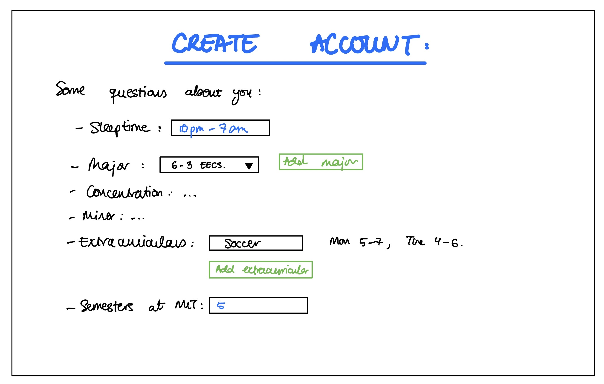
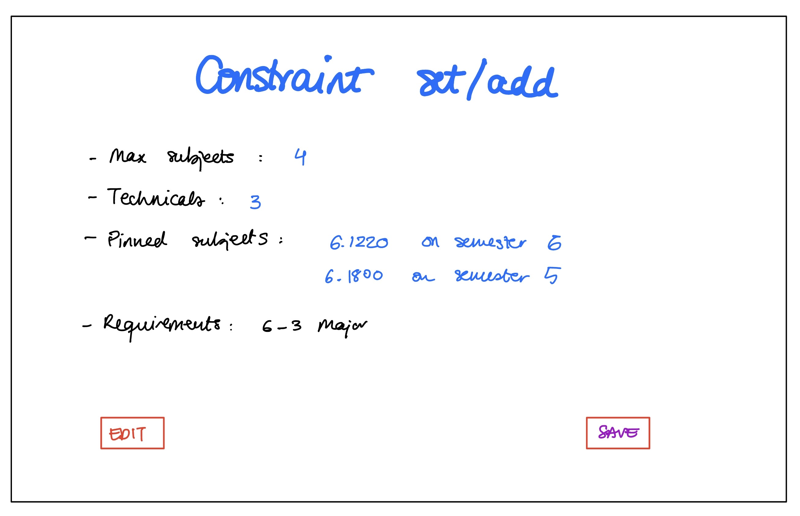
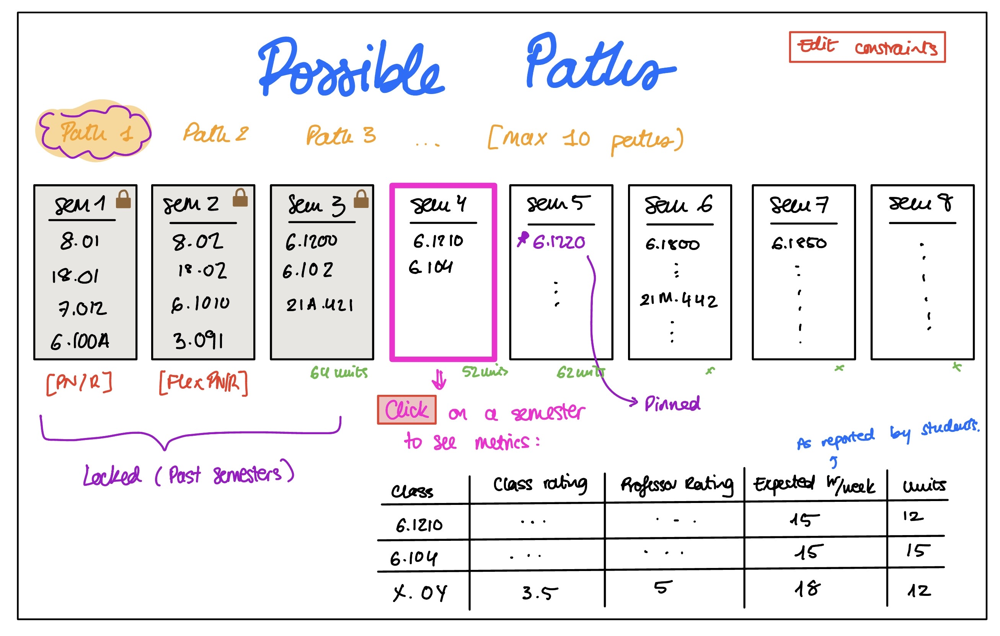

# **BFS-this-MESS**

## **PROBLEM FRAMING AND STAKE HOLDERS**

### **Domain:**

At MIT, we get to choose when and what courses to take, roughly. Each declared major has a set of requirements that they must fulfill, these being specific subjects or subjects from a subgroup (electives), and some subjects have others as their **pre-requisite**. Within those constraints, we are free to organize our semesters as we please. 

Naturally, this makes it a common problem all students must engage with: what classes to take. However, in reality, students are really trying to optimize their career plan to finish as soon as possible while satisfying some conditions such as: 

* making each semester a
enjoyable as possible, by planning to take classes you are intersted in; making sure that there will be enough hours in the week to give the alloted time to your classes while accounting for 8h of sleep, time to eat, extracurriculars, etc.; or capping the amount of technical vs. humanities classes you take.

* Making each semester as easy as possible by ensuring no lecture/recitation conflicts and choosing classes with good lecturers.

One tool that students use is called CourseRoad, which displays a semester view, into which you can drag and drop subjects. The task is manual, but shows course pre-requisites as you add the classes, progress toward major completion and a projection of your schedule per planned semester.

### **Bad situations:** 

As I mentioned, there exists a website called CourseRoad which enables you to visualize your semesters and drag and drop classes to draft your plan. As a result, a large population of MIT students spend a lot of their time on said website, constantly composing a plan through trial and error. 

They test what would happen if they take subject x in their 4th semester; how would that move their other subjects? would it fit in their schedule? Is the professor good that year? Then they might try the same subject x in their 5th semester and repeat the process. Then test subject y: can they fit it in? If they can't, what could they switch out? Now that they have switched that subject out, how does that affect what came after it? And so on and so forth over the infinite permutations that result from such an extensive subject listing at MIT.

As a result, navigating CourseRoad alone is not enough. One still has to access other websites like Hydrant to check schedule conflicts and manually navigate the subject listing to find interesting courses. Sometimes, there will be classes one will be interested in that they didn't even know they could take or that were being offered if they are maybe not in one's major. 

For example, I remember wanting to take a class in Anthropology and took "How culture works"- a pretty standard name for lookup. But as I scrolled through the subject listing, I came accross a class called "Images of Asian Women: Dragon Ladies and Lotus Blossoms". There is no way that I would have found that class, which would have been interesing to me, through a word search without prior knowledge of its existance.

It becomes evident how the process of subject discovery reduces mostly to word of mouth or a time consuiming search. On top of it all, finding lecturer and class ratings is on an entirely different website...

Without necessarily being conscious of it, they are setting constraints on a directed graph and discovering possible solutions with those constraints but in an unorganized, spontaneous, non exhaustive and especially volatile way. Usually students will make all edits on one same "road", and therefore will lose previous progress, or they might add extra subjects in a semester as placeholders. It would be rare that they create one new "road" for every set of constraints that they are exploring, because that would be too time consuming, repetitive and prone to error. However, they end up spending an equally large amount of time on this trial and error system as it is.

Additionally, there is no easy way to share a specific "road" with an advisor (or another student). This forces the student to reiterate to their advisor every semester what their overall plan, share screen, etc.

### **Corroboration:** 

Most of the evidence supporting my claim is based on the behavior I have observed in the students around me. It is very common to find students in common areas on campus, such as Stata or the Stud, with their computers open either on CourseRoad or Google Calendar. It is almost like a pastime but obviously exaggerated around registration week. Even during class time you might see people reiterating on their CourseRoad. This only comes to show that students spend a lot of time planning ahead on this website.

Moreover, I found [this MIT admissions article](https://mitadmissions.org/blogs/entry/a-walk-down-courseroad-lane/) from when CourseRoad first came out and, even though the website has been hugely improved since 2015, it is able to represent the sentiment I am trying to encapsulate. At some point Joel says, "*I’ve probably spent more time planning my courses at MIT than I have on all of my biology classes I’ve ever taken*", and this is exactly the bad situation that I think still exists today. Throughout the article, he also describes the thought process of a student using CourseRoad, in case the reader needed more clarification.

Lastly, I have personally asked some of my friends for features that they wish were available on CourseRoad, apart from the solution I describe in the section below, and they suggest professor ratings and on-site (without having to access Hydrant) approximations of when each class meets based on previous offerings to see if the classes they are combining would be compatible. These would be features I would like to incorporate in my solution although they are not the main drive of it.

### **Workarounds and comparables:** 

Hydrant is one small addition that allows you to check whether a set of classes would be compatible schedule-wise in a fast manner. Otherwise, the workaround is to add many different "roads", to modify one "road" and lose the current progress, or to add placeholders in each semester's slot, but then it loses organization.

In terms of subject listing, one either knows what class they want to take or in what department and skims their offerings, or bases their search on word of mouth. 

### **Solution sketch:** 

The idea is to be able to set certain constraints on our graph, e.g.: being a 6-3 major and therefore having to take all the 6-3 requirements at some point, in an allowed order, or knowing that at some point in your time at MIT you want to take 2.004, or that you want to take 2.004 specifically in your 5th semester.

The subjects can be represented as a directed acyclic graph, where each subject is a node and an edge from subject A to subject B represents that A is a pre-requisite for B. A student's plan can then be represented as a sequence of sets of subjects, where each set corresponds to a semester. For a subject to be included in a semester, all of its pre-requisites must have been taken in one of the previous semesters. Therefore, if the set of subjects already completed is the current state, the subjects that can be taken in the next semester are the ones whose pre-requisites are all contained in that state.

The first state would depend on the student. When creating a plan, the student could specify whether they already have credit for any subjects or requirements. These would make up the initial state. For a freshman with no previous credit, the initial state would simply be empty, and the system would determine which subjects can be taken in the first semester based on the student's requirements and the other constraints. For a sophomore in their Spring semester, the initial state would be the 3 sets of subjects they took in their first 3 semesters.

Other mandatory constraints will be the number of hours you would like to sleep per night, how many hours a day you spend on extracurriculars, taking care of yourself, etc.

Once all the constraints that the user desires have been configured, there will be a subset of plausible paths available to them for each configuration. An idea is to filter what paths to show by user's interest. Say they have decided on what technical classes to take and they know they want to take a HASS that semester but dont know which one yet, so they have left that slot blank. In that case, they could select what department to explore, or what topic, to shrink the number of possible "shortest paths".

Then, each road could be a specific locked constraint set, like when one saves the configuration of a filtered search. Hopefully this will help students save manual labor of trial and error and substitute with a direct visualization of the options available with each set of constraints.

### **Stakeholders:**

1. Student: Wants to optimize their schedule
2. Advisor: Gains access to the shared plans of all their advisees so they can easily review them and suggest changes.
3. Professors: Small courses benefit from a borader spectrum of students learning about their class.
4. Registrar: Website will serve as an incentive for the students to rate their classes, since the ratings become more accessible.

## **APPLICATION PITCH**

- **Name:** BFS this mess (bfsthismess.mit.edu)
- **Motivation:** Find list of possible shortest cours3e paths given a set of constraints.
- **Key features:**
    - FindPaths: Return a list of possible shortest paths fiven some constraints.
    - SubjectSuggest: Based on interests, suggest classes to fill requirements.
    - Shareability: Share your paths with your advisor for them to approve.

## **CONCEPT SPECIFICATIONS AND ESSENTIAL REACTIONS**

### **Conventions:**
* **Subject** is the generic type for a course/subject in all concepts. 
* Semesters are numbered along the student's timeline: semester 1 is the first Fall at MIT, so odd numbers are Fall and even numbers are Spring. Semester 0 holds credit the student arrives with (e.g. AP credit, transfer credit, etc.). 
* A **plan** is a list of sets of subjects, one per semester, where the k-th set (counting from 0) is semester k. 
* The past is not a separate input: subjects the student has already taken are **pinned** to the semester they were taken in, and those semesters are **locked** (see CONSTRAIN), so a plan always describes the whole timeline and the search only ever fills in what comes after the locked semesters. 
* A **road** holds constraints; a **plan** is one possible answer that satisfies a road.
### **CONCEPTS**

1. **COURSE_OFFERING** [Subject]

    - **Purpose:** Store information about MIT subjects, including when subjects are offeredtheir metadata (level, terms, offering status, repeatability), prerequisites, corequisites, and evaluation ratings with source links.

    - **Principle:** A course offering can be loaded from the [MIT Subject Listing](https://student.mit.edu/catalog/index.cgi) extracting key properties, such as its pre-requisites and the semesters in which it is offered. Ratings associated with each class and lecturer should also be extracted from MIT's [Subject Evaluation Reports](https://eduapps.mit.edu/ose-rpt/?Search+Online+Reports=Search+Subject+Evaluation+Reports) site.

    - **State:**
        * *courses*: a set of Subjects with
            * a *name* String
            * a *course Id* String
            * a *description* String
            * a *lecturer* String
            * a *level* String (e.g., Undergraduate vs Graduate)
            * a *terms* set of Strings (e.g., "Fall", "IAP", "Spring", "Summer")
            * a *offering* String (e.g., "Offered normally", "Not offered THIS year", "Not offered NEXT year", "Not currently listed")
            canBeRepeated Boolean
            * a *units* String (optional, e.g., "3-0-9")
            * a *meetingTimes* String (optional, e.g., "TR2.30-4")
            * a *location* String (optional, e.g., "36-153")

            * Attributes in accordance with [MIT Subject Listing & Schedule Symbol Definitions](https://student.mit.edu/catalog/symbols.html).

        * *prerequisites*: mapping from a course to its set of prerequisite courses (NOT recursive, if a prereq has a prereq, only list the direct pre-reqs). The prerequisite graph is derived from this mapping.

        * *corequisites*: mapping from a course to its set of corequisite courses.

        * *ratings*: partial mapping from a course to its class and professor ratings, and source URL (courses without evaluation data have no entry).

    - **Actions:**
        * *load* (subjectListingURL: String, ratingsURL: String) : return (count: Number)
            * **where** subjectListingURL and ratingsURL can be retrieved and parsed
            * **then** extract the courses, course IDs, descriptions, lecturers, semesters offered, technical flags, prerequisites, corequisites, and ratings. Store them in courses, prerequisites, corequisites and ratings respectively. Return the number of courses stored.

        * *prerequisites* (course: Subject) : return (prerequisites: set of Subject)
            * **where** course is in courses
            * **then** return the set of direct prerequisites of course if course in prerequisites, else return empty set.

        * *corequisites* (course: Subject) : return (corequisites: set of Subject)
            * **where** course is in courses
            * **then** return the set of corequisites of course if course in corequisites, else return empty set.

        * *isOffered* (course: Subject, semester: String) : return (offered: Boolean)
            * **where** course is in courses
            * **then** return whether course is offered in the specified term and available according to its offering status.

        * *ratings* (course: Subject) : return (found: Boolean, classRating: Number, professorRating: Number, url: String)
            * **where** course is in courses
            * **then** if course is in ratings, return found = true with the class rating, professor rating, and source URL associated with course; otherwise return found = false.

        * *search* (query: String) : return (courses: set of Subject)
            * **where** query is not empty
            * **then** return every course whose name, description **or** course Id contains query, ignoring case.

        * *catalog* () : return (prerequisites, corequisites, offered, technical)
            * **then** return the prerequisites, corequisites, terms, and offering status of all courses, so other concepts can use them without reading this concept's state.

        * *schedule* (course: Subject) : return (found: Boolean, units: String, meetingTimes: String, location: String)
            * **where** course is in courses
            * **then** if course has meetingTimes (is not empty/null), return found = true with its units, meeting times, and location; otherwise return found = false.

### 2. **CONSTRAIN** [Subject]

- **Purpose:** Maintain the set of constraints that a user wants their course plans to satisfy, including major requirements, elective blocks, credit/course caps, and historical timeline locks.

- **Principle:** A user creates a road and adds constraints to it, such as a specific subject in a specific semester, or capping every semester at 4 subjects. They can later relax or remove a constraint to widen the set of valid plans. Possible plans can be found by checking against the constraints of the road to determine whether it is valid. The student's past is expressed the same way: a subject already taken is pinned to the semester it was taken in, and those past semesters are locked so that nothing else can be added to them.

- **State:**
    * *roads*: a set of roads with
        * a *name* String
        * a *major* String (e.g., "6-3", "2-A") 
        * a *required* set of Subjects (must be taken at some point)
        * a *elective_blocks* set of sets of Subjects (one   subject must be taken from each block)
        * a *pins* set of pins
        * a *maxPerSemester* Number (0 means no cap)
        * a *maxTechnicalPerSemester* Number (0 means no cap)
        * a *lockedThrough* Number (semesters 0 up to and including lockedThrough are locked; 0 means only the incoming-credit semester is locked)

    * *pins*: a set of pins with
        * a Subject
        * a semester Number (0 for incoming credit, 1 for the first Fall, and so on)

    A pinned subject must appear in every valid plan, whether or not it is also required. A *locked* semester contains exactly the subjects pinned to it, no more and no fewer; it is how history is recorded.

- **Actions:**
    * *newRoad* (name: String, major: String) : return (road: Road)
        * **where** name is not empty
        * **then** create a new road with this name, the specified major, no constraints, maxPerSemester set to 0, maxTechnicalPerSemester set to 0, and  lockedThrough set to 0, and return it.

    * *setMajor* (road: Road, major: String)
        * **where** road exists and major is not empty
        * **then** update the major attribute of road to reflect new degree requirements.

    * *addRequirement* (road: Road, subject: Subject)
        * **where** road exists
        * **then** add subject to the required subjects of road.

    * *removeRequirement* (road: Road, subject: Subject)
        * **where** road exists and subject a requirement
        * **then** remove subject from requirements

    * *addElectiveBlock* (road: Road, options: set of Subject)
        * **where** road exists and options is not empty
        * **then** add options to the elective blocks of road.

    * *removeElectiveBlock* (road: Road, options: set of Subject)
        * **where** road exists and options is an elective block of road
        * **then** remove options from the elective blocks of road.

    * *pin* (road: Road, subject: Subject, semester: Number)
        * **where** road exists and semester is at least 0
        * **then** If a pin for subject exists in road, set its semester to the given semester, otherwise create a new pin for subject with this semester and add it to road.

    * *unPin* (road: Road, subject: Subject)
        * **where** road exists and a pin for subject exists in road
        * **then** remove the pin from road and delete it

    * *setCap* (road: Road, capType: String, limit: Number)
        * **where** road exists, limit is at least 0, and capType is either "total" or "technical"
        * **then** if capType is "total", set maxPerSemester to limit; if capType is "technical", set maxTechnicalPerSemester to limit (0 removes the respective cap).

    * *lockThroughSemester* (road: Road, semester: Number)
        * **where** road exists and semester is at least 0
        * **then** set the lockedThrough of road to semester. Semesters 0 through semester now contain exactly their pinned subjects (a locked semester with no pins is empty).

    * *constraints* (road: Road) : return (required, elective_blocks, pins, maxPerSemester, maxTechnicalPerSemester, lockedThrough)
        * **where** road exists
        * **then** return the constraints currently stored for road.

    * *satisfies* (road: Road, plan: list of set of Subject, technical: set of Subject) : return (satisfied: Boolean)
        * **where** road exists
        * **then** return true if (the k-th set of plan, counting from 0, is semester k): every required subject appears in some set of plan, at least one subject of every elective block appears in some set of plan, every pin in road has its subject in the set of plan at the pin's semester, every locked semester (0 through lockedThrough) contains exactly the subjects pinned to it, and, for the semesters after lockedThrough, if maxPerSemester is not 0, no set has more than maxPerSemester subjects, and if maxTechnicalPerSemester is not 0, no set has more than maxTechnicalPerSemester subjects that are in technical. Otherwise return false. (Caps are not applied to locked semesters, since history is a fact and not a choice.)

    * *findPath* (road: Road, catalog, limit: Number) : return (paths: list of list of set of Subject)

        * **where** road exists, limit is at least 1, and catalog holds the prerequisites, corequisites, semesters offered and technical flags of the subjects (as returned by COURSE_OFFERING.catalog).
        * **then** return the shortest possible plans that satisfy the constraints of road. Each plan is a list of sets of subjects, one set per semester, starting at semester 0, so the locked semesters appear first exactly as pinned and only the semesters after lockedThrough are chosen by the search. If no valid plan exists, return an empty list. 

### 3. **SHARE** [Road, User]

- **Purpose:** Allow students to share their course plans with advisors or other students.

- **Principle:** A student can share a road so that another person can view its constraints and the course plans generated from them. The viewer always sees the current state of the road.

- **State:**
    * a set of Accesses with:
        * An *owner* String (the user who owns it).
        * An *accessList* a set of user Stings who can access it.
        * The *road* Road object we are referring to.

- **Actions:**

    * *claim* (road: Road, user: User)
        * **where** road has no owner
        * **then** set user as the owner of road.

    * *share* (road: Road, requester: User, user: String)
        * **where** road exists, requester is the owner of road, and user is not empty.
        * **then** add user to the set of users who can access road and its associated course plans.

    * *canView* (road: Road, user: User) : return (allowed: Boolean)
        * **then** return true if user is the owner of road or is in the accessList of road, otherwise false.

    * *isOwner* (road: Road, user: User) : return (owner: Boolean)
        * **then** return true if user is the owner of road, otherwise false.

### 4. **AUTHENTICATION** [User]

- **Purpose:** Establish the identity of the person using the application, so roads can be owned and shared.

- **Principle:** A person registers with a username and password, then logs in to get a session. Requests that carry that session are attributed to that user until they log out.

- **State:**
    * *users*: a set of users with a unique username String and a password hash
    * *sessions*: a mapping from a session String to a user

- **Actions:**
    * *register* (username: String, password: String) : return (user: User)
        * **where** username and password are not empty and username is not taken
        * **then** create a user with this username and the hash of the password, and return it.

    * *login* (username: String, password: String) : return (session: String)
        * **where** a user with this username exists and the password matches
        * **then** create a new session for that user and return it.

    * *logout* (session: String)
        * **where** session exists
        * **then** remove session.

    * *authenticate* (session: String) : return (user: User)
        * **where** session exists
        * **then** return the user of session.

### **REACTIONS**

1. **loadCatalog**
    * **when** Request.loadCatalog (subjectListingURL, ratingsURL)
    * **then** COURSE_OFFERING.load (subjectListingURL, ratingsURL)

2. **newRoad**
    * **when** 
        * Request.newRoad (session, name)
        * CONSTRAIN.newRoad (name) : (road)
    * **where**  user = AUTHENTICATION.authenticate (session)
    * **then**   SHARE.claim (road, user)

3. **findPaths**
    * **when** Request.findPaths (session, road, limit)
    * **where**
        * user = AUTHENTICATION.authenticate (session)
        * SHARE.canView (road, user) = true
        * catalog = COURSE_OFFERING.catalog ()
    * **then** CONSTRAIN.findPath (road, catalog, limit)

4. **shareRoad**
    * **when** Request.share (session, road, advisor)
    * **where** requester = AUTHENTICATION.authenticate(session)
    * **then** SHARE.share (road, requester, advisor)

5. **viewRoad**
    * **when** Request.viewRoad (session, road, limit)
    * **where**  
        * user = AUTHENTICATION.authenticate (session)
        * SHARE.canView (road, user) = true
        * catalog = COURSE_OFFERING.catalog ()
    * **then**
        * CONSTRAIN.constraints (road)
        * CONSTRAIN.findPath (road, catalog, limit)

## UI SKETCHES

## USER JOURNEY

Omar is a junior in 6-3 and it is the week before registration. He is in Stata with CourseRoad open, moving 6.1220 and 6.1800 between semesters, and every change shifts his other subjects around. He also knows he has to keep his schedule workable, because he wants to sleep from 10pm to 7am and make sure he has time for his soccer practices. Instead of editing the same road again, he opens BFS-this-MESS and fills out the Create Account page with his sleep time, his 6-3 major, his soccer practice times, and how many semesters he has been at MIT.

Next, he goes to the Constraint set/add page and enters what he wants his plan to follow: at most 4 subjects per semester, at most 3 technical ones, and the 6-3 major requirements. He pins 6.1220 and 6.1800 to the semesters he wants them in and clicks Save. Whenever he wants to try something different, he can click Edit and change a constraint without losing the rest.

Finally, he gets to the Possible Paths page, which shows up to 10 paths made of semester columns. His past semesters are locked, and his pinned subjects are marked, so he can see right away how his pins fit. He clicks on semester 4 to see the metrics for each of its classes, such as class rating, professor rating, expected hours per week, and units, and he sees that it is a lighter semester than the ones after it. He flips through Path 2 and Path 3 to compare, picks the one he likes, and instead of hours of trial and error, he has a plan that fits his constraints.