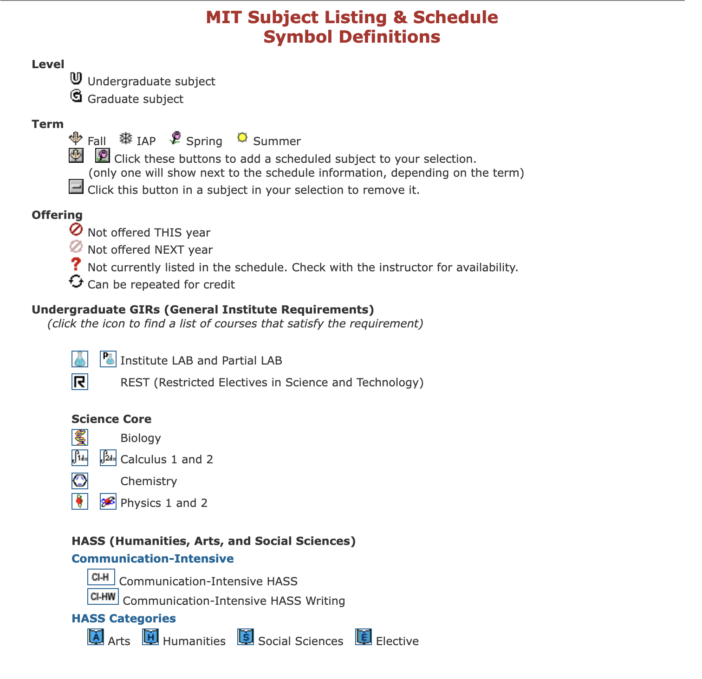

# TUE OCT 13
* Probably need to add a SEARCH concept or feature for users to add their classes.

* User journey: 

    1. Register:
        - Create username and password
        - Verify email
        - Fill in initial questionaire
    2. Set filters:
        - Fix subjects
        - Lock semesters
    3. Calculate paths:
        - Compute possible paths
        - Visualize paths and metrics
    4. Save path
    5. Share path
    6. Return to, copy and delete saved paths.
    7. Paths are a set of constraints
* Ratings mapping will need a url to the ratings for user accesibility and app credibility.
* Need REFRESH reaction to update app with MIT website info
* **Concept design review:**
    1. ****COURSE_OFFERING****
        
        1. Only show lecturer if the subject is offered this semester. Otherwise the website will say staff... Or just parse staff? 
            Parse Lecturer name or *Staff*. Handle each case in UI, not backend.
        2. For semesters offered, the MIT sbject listing website usially says fall or spring, and in the case that there is an exception like the subject not being offered in a specific semester, it will say this then... How do I represent that. Is that part of the state or do I check explicitly in IS_OFFERED() upon a call, or do I mirror their structure?
            * **MIT Subject Listing & Schedule Symbol Definitions:**
            

            Update attributes to include this terminology

        3.  In ratings, we probably want to include a link to the ratings we are sourcing from, so maybe we want ratings to just be a link to the urls for that class and lecturer and a reaction will later handle info extraction?

            Include as an attribute

        4. I intended is_technical to represent subjects that are in you major, so this depends on the user and no longer feels like it belongs in course_offering... Technicals for theatre majors would be courses in 21T, where for a 6-3 major they would be hasses. I'm not sure how to define technical, and I think it should be called is_technical in the state, not just technical since it represents a boolean

            technical doesn't belong in course_offering because it is major specific.

        5. For search, do we need to know the data structure first or is the query not the concept's concern?

        6. Need to add schedule data
        

# WED OCT 14
